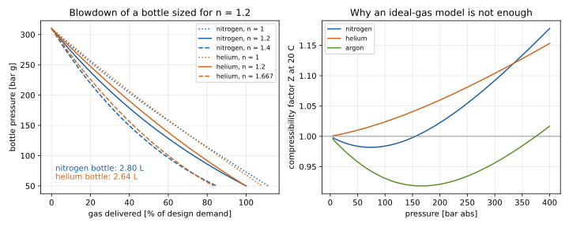

# pressurant-sizer

[](https://github.com/sushkoivan/pressurant-sizer/actions/workflows/ci.yml)

**How big does the gas bottle have to be?** Real-gas sizing of pressurant bottles for pressure-fed liquid
rockets, cold-gas thrusters and test stands, in pure Python with no dependencies.



Most quick estimates use `pV = mRT`. At 300 bar, nitrogen is about 12 % less dense than an ideal gas says,
and the gas left in the bottle cools as it expands. Together these make a hand-calculated bottle undersized,
by about 16 % in the example below. `pressurant-sizer` uses the Peng-Robinson equation of state and a
polytropic blowdown. It also gives you the bottle volume, the gas you have to load, and the stored energy
(an indicator of the hazard).

## Features

- **Peng-Robinson real-gas model** for N₂, He, Ar, air and CO₂. You can switch to the optional
  [CoolProp](http://www.coolprop.org/) backend for reference-quality properties.
- **Mixed demands:** propellant tanks (ullage temperature, gas dissolving into the propellant, tanks
  pre-pressurised on the ground), cold-gas thrusters (Isp can differ per gas), and fixed masses such as purges.
- **Polytropic blowdown,** from isothermal (n = 1) to adiabatic (n = γ), including the regulator dropout.
- **Gas comparison** in one run, e.g. N₂ vs He: volume, loaded mass and stored energy.
- **Side-by-side ideal-gas answer,** so you can see what the real-gas model changes.
- **Blowdown curve:** bottle pressure and temperature vs gas delivered, ready for plotting.
- CLI with JSON case files, and a Python API. Standard library only. Python ≥ 3.10.

## Install

```bash
pip install git+https://github.com/sushkoivan/pressurant-sizer
# optional reference-quality properties:
pip install CoolProp
```

## Quick start: command line

```bash
python -m pressurant examples/biprop_vehicle.json --sweep
```

```
Pressurant: nitrogen
1. Demand
   oxidiser tank                    398.1 g
   fuel tank                        181.6 g
   roll thrusters                   100.4 g
   post-flight purge                 20.0 g
   total                            700.1 g  x (1 + 0.15 margin) = 805.1 g
2. Bottle
   full      310 bar g    20.0 C   rho  324.67 kg/m3
   empty      50 bar g   -56.3 C   rho   86.74 kg/m3   (polytropic n = 1.2)
   usable 237.92 g of gas per litre of bottle
3. Result
   required volume      3.38 L   (ideal gas would say 2.83 L)
   gas charged         1.099 kg
   stored energy         212 kJ  (~51 g TNT, indicative)
   blowdown sensitivity: n 1: 3.04 L,  n 1.2: 3.38 L,  n 1.4: 3.99 L
...
Comparison
   gas              volume [L]  gas mass [kg]  energy [kJ]
   nitrogen               3.38          1.099          212
   helium                 4.65          0.214          195
```

Without a file, you describe the case directly on the command line:

```bash
# tank: NAME,VOLUME_L,P_BARG[,ULLAGE_T_C[,DISSOLUTION]]   thruster: NAME,THRUST_N,ISP_S,FIRING_S[,COUNT]
python -m pressurant --gas N2,He --fill 300 --tank ox,8,35,-10,0.05 --tank fuel,4,35 --thruster rcs,2,65,8,4
```

Options: `--fill` (bar g), `--fill-temp` (°C), `--dropout` (bar), `--n`, `--margin`, `--sweep`,
`--coolprop`, `--json out.json`.

## Quick start: Python

```python
import pressurant as P

demands = [
    P.TankDemand("oxidiser", volume=8e-3, pressure=P.bar_g(35), t_gas=263.15, dissolution=0.05),
    P.TankDemand("fuel", volume=4e-3, pressure=P.bar_g(35)),
    P.ThrusterDemand("roll RCS", thrust=2.0, isp={"N2": 65, "He": 160}, firing_time=8.0, count=4),
]
r = P.size_bottle("N2", demands, p_fill=P.bar_g(310), dropout=15e5, n=1.2, margin=0.15)
print(r.report())
print(f"{r.volume_l:.2f} L, {r.charged_mass:.2f} kg N2")

curve = P.blowdown_curve("N2", r.volume, r.p_fill, r.t_fill, r.p_min)   # (delivered kg, p Pa, T K)
```

All inputs are SI with absolute pressures (Pa). `bar_g()` / `to_bar_g()` convert to and from gauge bar.

## Method

1. **Demand.** Each consumer becomes a gas mass.
   - Tank: $m = \rho(p_{tank}, T_{ullage})\, V\, (1 + f_{diss})\,(1 - f_{pre})$
   - Thruster: $m = n_{thr}\, \dfrac{F}{I_{sp}\, g_0}\, t_{fire}$
2. **Supply.** The bottle counts as empty at $p_{min}$ = highest tank pressure + regulator dropout.
   The gas left in the bottle follows $T = T_0 (p/p_0)^{(n-1)/n}$, so the usable density is
   $\rho_u = \rho(p_0, T_0) - \rho(p_{min}, T_{end})$.
3. **Volume.** $V = m\,(1 + \text{margin}) / \rho_u$.
4. **Real gas.** $\rho = p / (Z R T)$, where $Z$ is the largest real root of the Peng-Robinson cubic
   $Z^3 - (1-B)Z^2 + (A - 3B^2 - 2B)Z - (AB - B^2 - B^3) = 0$, solved in closed form (Cardano).
5. **Stored energy** (indicative): $E = \dfrac{p_0 V}{\gamma - 1}\left[1 - (p_{atm}/p_0)^{(\gamma-1)/\gamma}\right]$.

### Accuracy

Peng-Robinson compared with CoolProp's reference equations at 20 °C:

| gas | 200 bar | 300 bar |
|---|---|---|
| N₂ | Z −2.8 % | Z −4.2 % |
| He | Z −3.2 % | Z −3.3 % |
| Ar | Z −2.5 % | — |
| air | Z −2.9 % | — |

Peng-Robinson slightly over-predicts gas density at high pressure, so its bottles come out **a few percent
small**. Keep a margin of at least 10 %, or run with `--coolprop` for the final number. The tests
check the model against these reference values.

## Limitations

- Each bottle is a single lumped volume with a polytropic exponent. Wall heat transfer, regulator dynamics
  and line volumes all go into `n` and `margin`.
- Gas dissolving into the propellant (e.g. N₂ into N₂O) is a single factor. Measure it or take it from the
  literature; do not guess.
- Helium at cryogenic temperatures and CO₂ near its critical point are outside what Peng-Robinson does well.
  Use CoolProp there.

## ⚠ Safety

This tool is for **preliminary sizing**. A 300 bar bottle stores enough energy to kill. Buy certified
bottles, stay inside their rated pressure and temperature, and proof-test with water (hydrostatically),
never with gas. Have every pressure system reviewed by someone qualified.

## Development

```bash
pip install -e .[dev]
pytest
python examples/plot_blowdown.py docs/img/blowdown.svg   # needs matplotlib
```

---

*Born out of sizing the pressurisation system of a student VTVL rocketry project.*
MIT licence.
